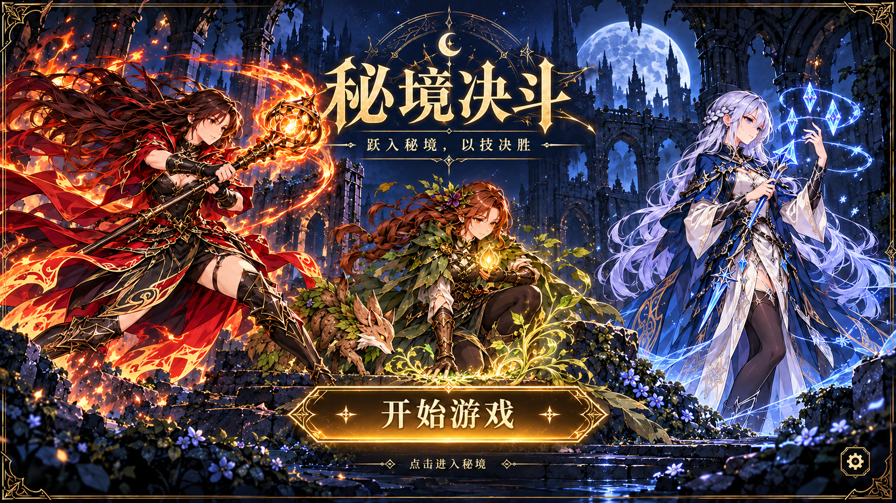
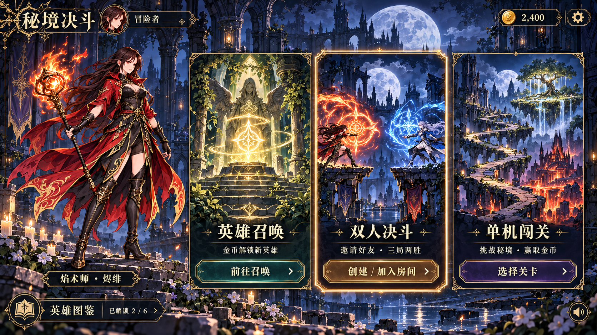
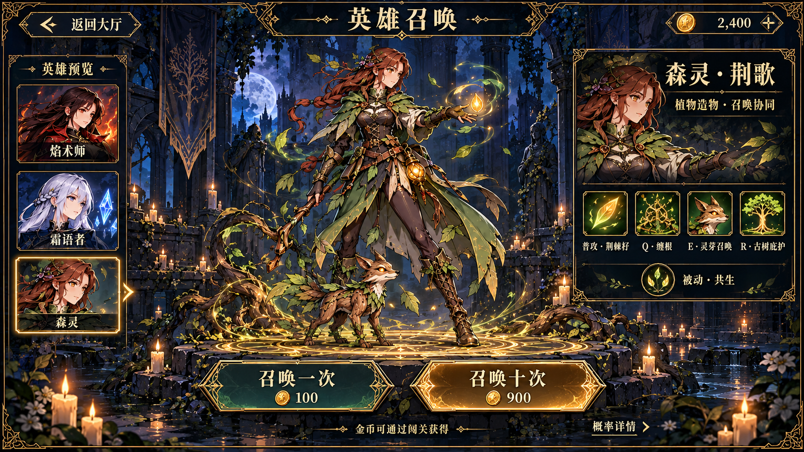
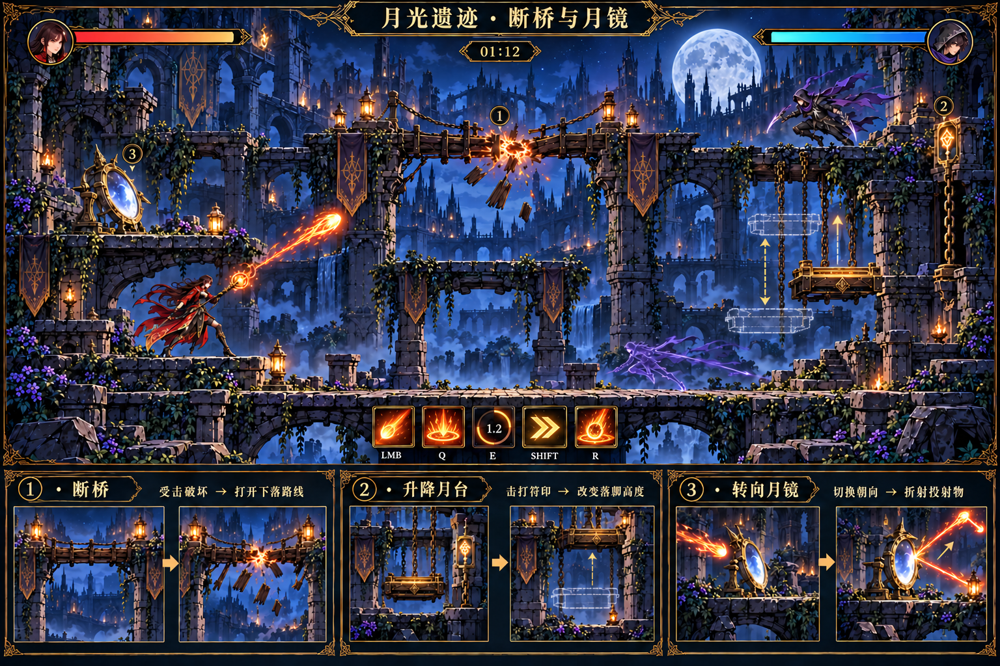
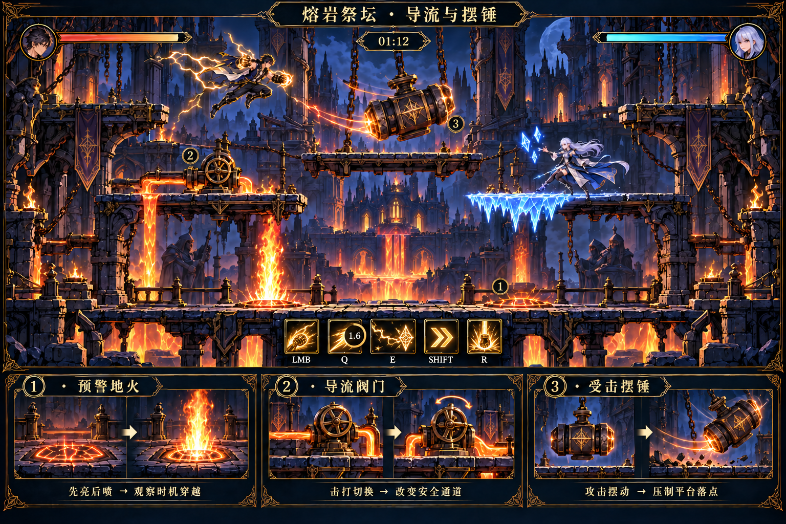
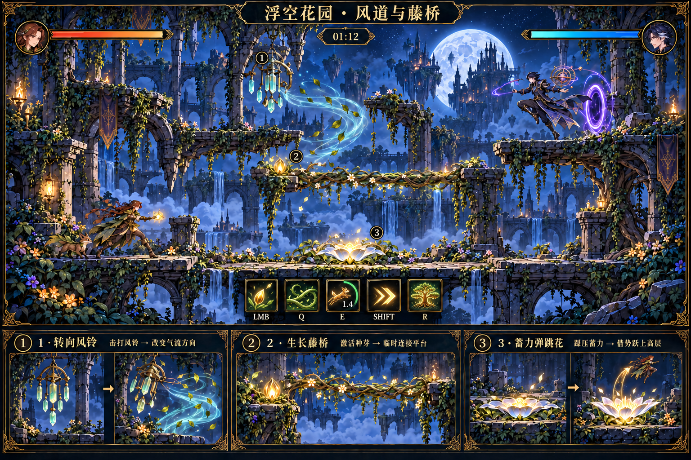

# 地图与 UI 概念设定

沿用既有六职业角色的暗色奇幻、手绘 2D 横版风格。此轮包括 3 张完整 UI 界面图和 3 张互动地图板。

## 界面路径

启动标题页 → 点击「开始游戏」 → 游戏主大厅。

大厅同时提供「英雄召唤」「双人决斗」「单机闯关」三个主入口，并显示金币、头像、英雄图鉴与设置。召唤池以金币招募角色。

| 页面 | 主内容 | 主要操作 |
|---|---|---|
| 启动页 | 游戏名、角色主视觉 | 开始游戏 |
| 游戏主大厅 | 三个模式入口、金币、玩家资料 | 进入召唤／创建或加入房间／选择关卡 |
| 英雄召唤池 | 角色预览、技能特征、金币消耗 | 单次召唤／十次召唤／返回大厅 |

UI 中的金币余额、消耗和解锁进度是展示数据；未增加真实付费入口。

## 地图交互

| 地图 | 机关 | 触发与反馈 | 战术用途 |
|---|---|---|---|
| 月光遗迹 | 断桥 | 受击开裂、木板掉落 | 打开下落路线，破坏对手落脚点 |
| 月光遗迹 | 升降月台 | 攻击符印切换高度 | 争夺高层、调整追击路线 |
| 月光遗迹 | 转向月镜 | 攻击改变镜面方向 | 折射投射物，构造攻击角度 |
| 熔岩祭坛 | 预警地火 | 地面先亮，再喷发 | 观察安全间隔、压制站位 |
| 熔岩祭坛 | 导流阀门 | 攻击阀门切换喷口线路 | 改变安全通道，逼迫换路 |
| 熔岩祭坛 | 受击摆锤 | 攻击让摆锤产生摆动 | 封锁平台落点，配合击退 |
| 浮空花园 | 转向风铃 | 攻击风铃切换气流倾向 | 改变空中路线与落点 |
| 浮空花园 | 生长藤桥 | 激活种芽生成临时藤桥 | 连接中层，利用消失时机反打 |
| 浮空花园 | 蓄力弹跳花 | 踩压后释放上弹 | 从底层回到高处，改变跳跃轨迹 |

## 共通规则

- 三层平台、左右绕行与底层回场路线，使双方持续可见且都有移动选择。
- 公共机关双方都可触发；机关状态和危险前摇需要在画面中清晰可读。
- 地形与职业技能可以组合；临时冰台、影标、木狐与传送门保持清楚的归属。
- 战斗 HUD 沿用人物头像、生命值、计时器和技能栏，二段窗口使用换图标与倒计时环。
- 图片为场景、交互和界面的概念稿；后续可据此拆分前景、背景、机关状态与 UI 素材。

## 图集

### 启动标题页

### 游戏主大厅

### 英雄召唤池

### 月光遗迹

### 熔岩祭坛

### 浮空花园

## 生成记录

使用内置 ImageGen。完整提示词、原始参考与修订提示词见《完整生成记录.json》；动作与技能栏的修订内容见《修订说明.md》。
