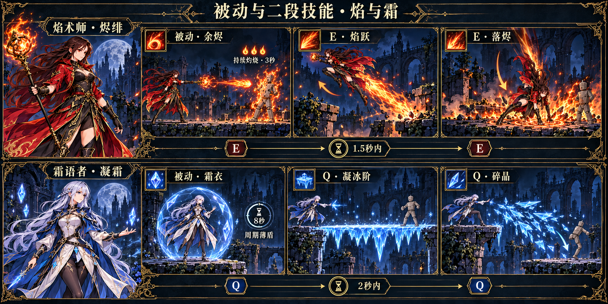
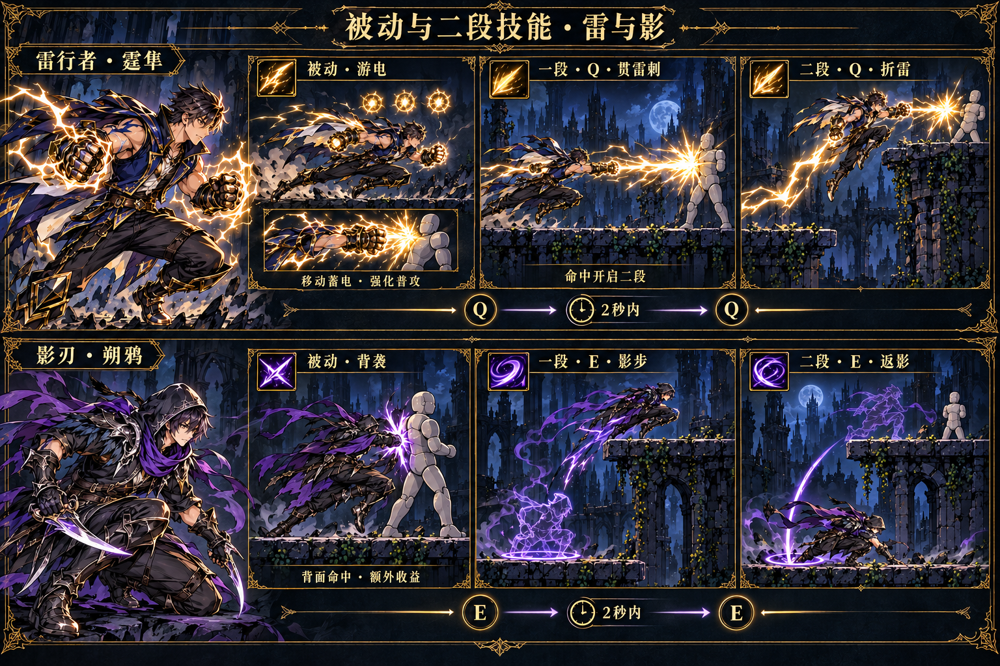
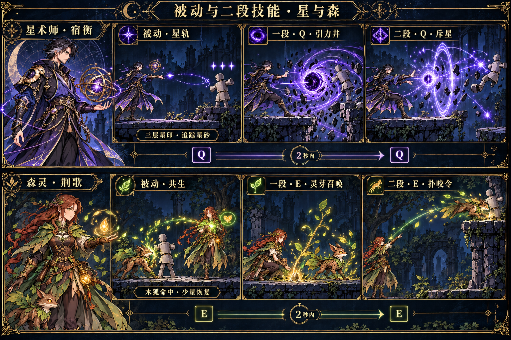

# 六职业概念图集

本套共 9 张概念图：6 张人物、动作与主要技能设定，3 张被动与二段技能补充。统一为暗色奇幻手绘横版风格。

每位角色包含：全身设计、正背面参考、待机／奔跑／起跳／下落／落地／普攻／受击／倒地 8 个动作，以及普攻、Q、E、R 技能。

## 阵容

| 角色 | 性别 | 主要定位 | 被动 | 二段技能 |
|---|---|---|---|---|
| [焰术师 · 烬绯](01-焰术师-烬绯-人物动作技能.png) | 女 | 爆发施法、灼烧压制 | 余烬 | 焰跃 → 落烬 |
| [霜语者 · 凝霜](02-霜语者-凝霜-人物动作技能.png) | 女 | 精准控场、冰台造路 | 霜衣 | 凝冰阶 → 碎晶 |
| [雷行者 · 霆隼](03-雷行者-霆隼-人物动作技能.png) | 男 | 高速突进、空中追击 | 游电 | 贯雷刺 → 折雷 |
| [影刃 · 朔鸦](04-影刃-朔鸦-人物动作技能.png) | 男 | 近身刺杀、留影换位 | 背袭 | 影步 → 返影 |
| [星术师 · 宿衡](05-星术师-宿衡-人物动作技能.png) | 男 | 引力操控、空间转移 | 星轨 | 引力井 → 斥星 |
| [森灵 · 荆歌](06-森灵-荆歌-人物动作技能.png) | 女 | 植物造物、召唤协同 | 共生 | 灵芽召唤 → 扑咬令 |

## 人物与动作

### 焰术师 · 烬绯

### 霜语者 · 凝霜

### 雷行者 · 霆隼

### 影刃 · 朔鸦

### 星术师 · 宿衡

### 森灵 · 荆歌

## 被动与二段技能

## 说明与生成记录

- [人物与主要技能说明](角色与技能设定.md)
- [被动、二段与触发规则](被动与二段技能.md)
- [完整生成记录与提示词](完整生成记录.json)

时间窗口、周期和强度为首轮概念值；图中动作是关键姿势设计，后续动画制作需补充过渡与连贯帧。
