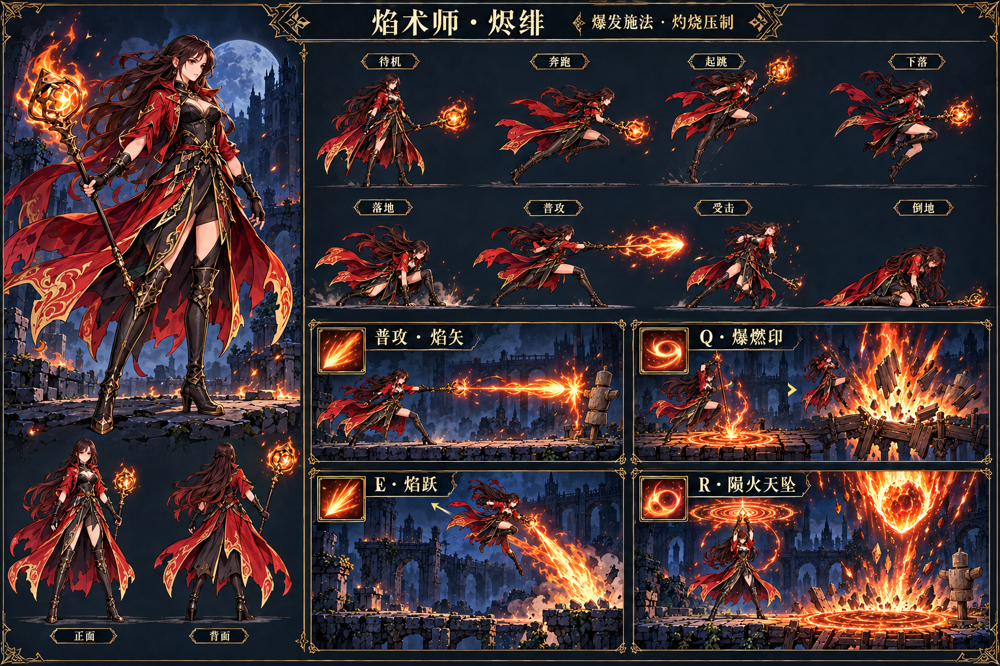
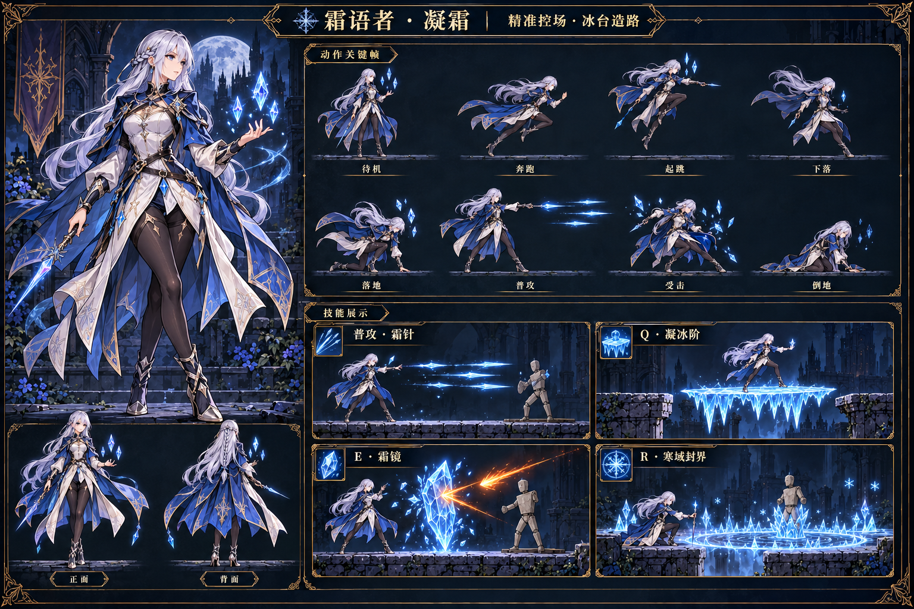
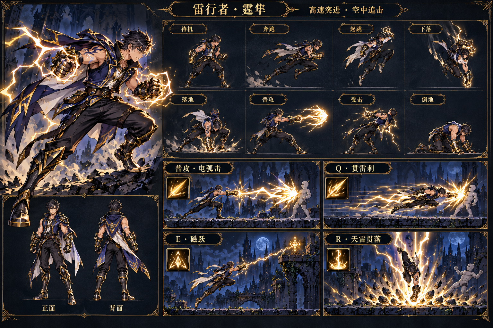
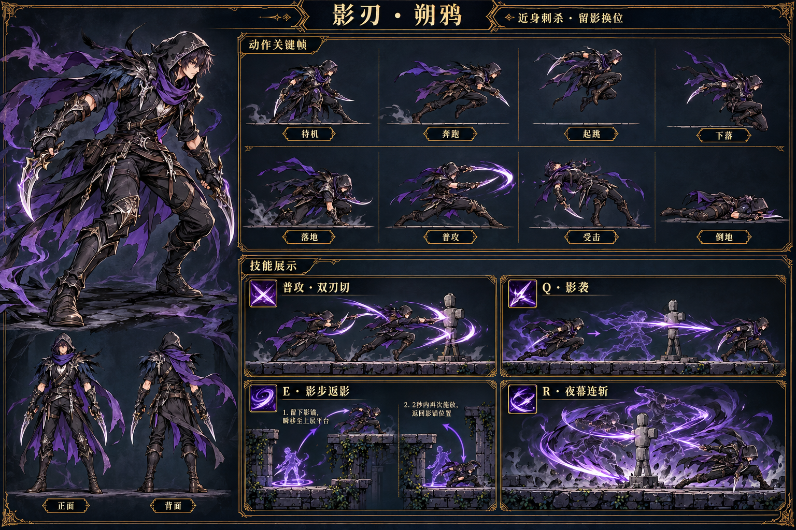
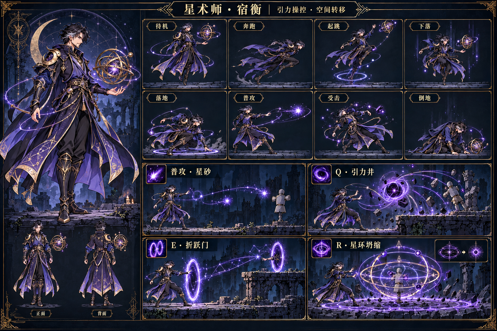
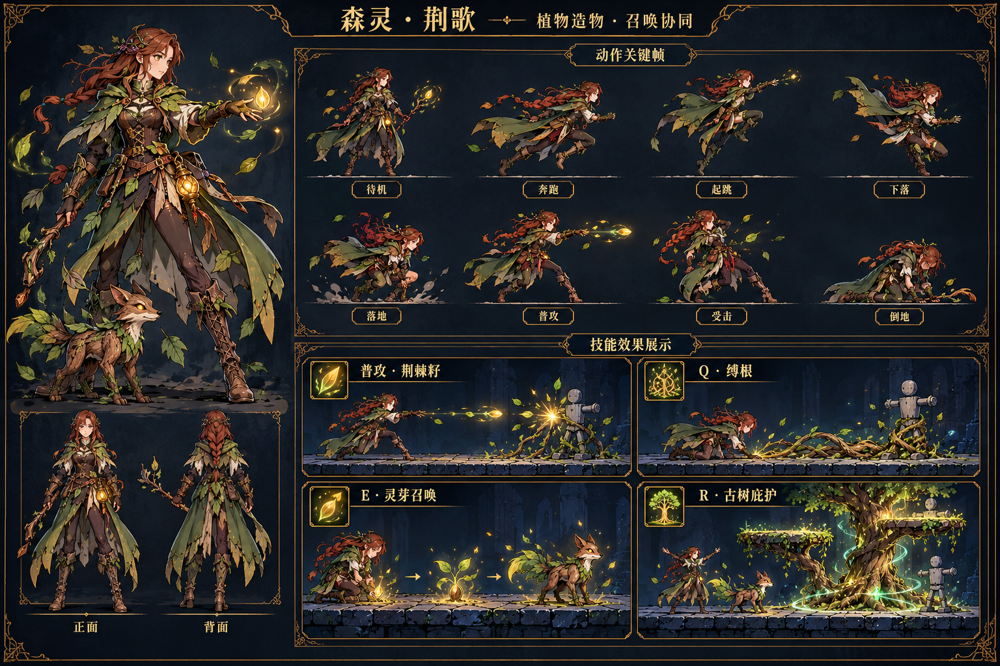

# 六职业人物、动作与技能概念

暗色奇幻横版平台对战游戏的首轮角色设定。每人包含全身设定、正背面参考、8 个基础动作，以及普攻和 Q/E/R 技能。图片使用内置 ImageGen 生成。

## 共同规则

- 统一手绘 2D 风格，战斗动作侧视面朝右，保持服装、武器、脸和配色一致。
- 基础动作：待机、奔跑、起跳、下落、落地、普攻、受击、倒地；特色技能另有独立施法动作。
- 图中为动作关键姿势概念；可播放动画还需制作过渡、起手、命中与恢复帧。
- 每个职业用轮廓、发力、技能形状和地形作用区分，不能只换颜色。
- 下列为概念提案，数值、冷却与作用时间在可玩版本中平衡。

## 焰术师 · 烬绯

爆发施法 · 灼烧压制。腰胯与肩部带动施法，爆发时重心前压、衣摆甩动。火焰强调冲击、余烬和可破坏地形。

| 按键 | 技能 | 作用与表现 |
|---|---|---|
| 普攻 | 焰矢 | 直线火弹；前送法杖，扭腰发力。 |
| Q | 爆燃印 | 延迟地面爆燃，向上击退并破坏木桥。 |
| E | 焰跃 | 向喷火反方向跃起，空中改变路线。 |
| R | 陨火天坠 | 长前摇陨火，落点预警清楚，用于封路与压制。 |

## 霜语者 · 凝霜

精准控场 · 冰台造路。手腕、指向与稳定落点体现精准控场。冰台和冰镜使用不同的施法姿势与几何轮廓。

| 按键 | 技能 | 作用与表现 |
|---|---|---|
| 普攻 | 霜针 | 紧密冰针直射，突出精准与晶体轮廓。 |
| Q | 凝冰阶 | 在空隙生成可站立冰台，双方均能利用。 |
| E | 霜镜 | 短暂冰镜反射投射物，反弹方向明确。 |
| R | 寒域封界 | 寒域限制移动，以边界预警和足部结晶体现冻结。 |

## 雷行者 · 霆隼

高速突进 · 空中追击。短跑、拳击与俯冲建立职业识别。雷电为金白色折线；空中移动借助可见导电锚点。

| 按键 | 技能 | 作用与表现 |
|---|---|---|
| 普攻 | 电弧击 | 护臂前击，释放短中距离电弧。 |
| Q | 贯雷刺 | 快速横向突进，利用短促电痕显示轨迹。 |
| E | 磁跃 | 牵引至上层导电锚点，争夺高处落点。 |
| R | 天雷贯落 | 从空中俯冲落地，引发雷击与冲击。 |

## 影刃 · 朔鸦

近身刺杀 · 留影换位。低姿态、短步和躯干扭转体现刺客。刀光贴近武器；影身必须半透明，与本体可辨。

| 按键 | 技能 | 作用与表现 |
|---|---|---|
| 普攻 | 双刃切 | 贴身双匕短连斩，重视进身时机。 |
| Q | 影袭 | 短距离低位突袭，打出穿身错位。 |
| E | 影步返影 | 起点留下影标并短距传送，2 秒内可再次按 E 返回。 |
| R | 夜幕连斩 | 夜幕范围内连续短斩，保留本体和地面可读性。 |

## 星术师 · 宿衡

引力操控 · 空间转移。悬浮、环形手势与浑天仪体现星术师。引力、成对传送与坍缩，以空间几何建立技能识别。

| 按键 | 技能 | 作用与表现 |
|---|---|---|
| 普攻 | 星砂 | 沿轻微弧线飞行的星砂弹。 |
| Q | 引力井 | 引力球拉动目标，干扰落脚点。 |
| E | 折跃门 | 在不同高度生成成对折跃门，改变进攻路线。 |
| R | 星环坍缩 | 星环先收缩再冲击，封锁一片有限空间。 |

## 森灵 · 荆歌

植物造物 · 召唤协同。播种、触地与抬枝的动作体现自然造物。缠根沿平台生长，木狐协同追击，古树提供临时落脚点。

| 按键 | 技能 | 作用与表现 |
|---|---|---|
| 普攻 | 荆棘籽 | 弹出种子，命中后萌发短暂荆棘。 |
| Q | 缚根 | 根须沿平台表面生长并束缚脚踝。 |
| E | 灵芽召唤 | 种子生长为木狐枝灵，协同追击。 |
| R | 古树庇护 | 古树形成两处枝台，并提供有限范围的恢复。 |

## 生成记录

完整提示词、参考图路径和输出文件名见同目录《完整生成记录.json》。被动与二段技能见《被动与二段技能.md》，全套图集见 README.md。
